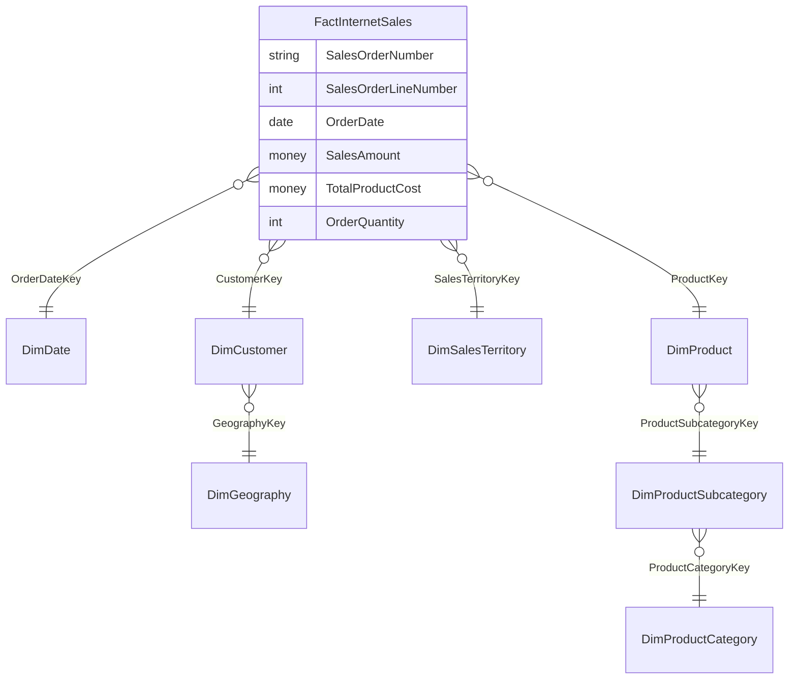
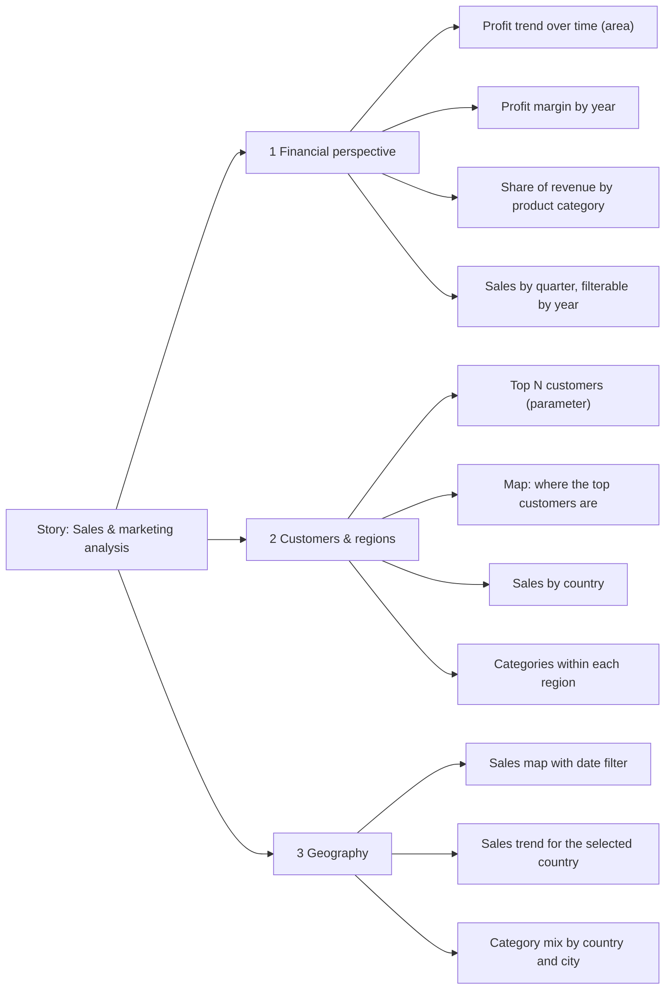

# Sales & marketing KPI dashboards in Tableau (AdventureWorks DW)

**A Tableau story for senior management. It covers the sales and marketing scenario of AdventureWorks, a bicycle manufacturer: it defines the KPIs, builds a single analysis table from a star-schema data warehouse with SQL, and presents 3 interactive dashboards.**


The task was to choose one business scenario from the AdventureWorks data warehouse and define the company's key performance indicators. Then the reports had to let management **find problems, analyse them and propose decisions**. I chose *Sales & Marketing* (internet sales).

## What is in the workbook

| Requirement | How it is implemented |
|---|---|
| Extract the data into a single table | SQL query joining the fact table with 7 dimension tables, at one row per order line ([`sql/`](sql)) |
| Story with 3 dashboards, at least 9 visualisations | Story **"Analiza prodaje i marketing"** with 3 story points and **11 visualisations** on the dashboards |
| Interactivity between visualisations | 2 filter actions (select a country or customer to filter the other charts) and 2 highlight actions |
| Filters | Order date / year, product category, state or province, and a set of sales-territory regions |
| At least 2 calculated fields | **9 calculated fields** (see below) |
| Drill-down on 2 or more dimensions | Year → Quarter, Territory country → City, Country → Customer |
| At least 1 parameter | **Top N Customers** (1-15, default 5) controls the customer ranking |

## Data model

The data warehouse is a star schema. `FactInternetSales` holds one row per order line, and the dimension tables describe the date, customer, geography, sales territory and product. The query flattens this into one table for Tableau:



The result has 21 columns:
- **Measures:** sales amount, product cost, extended amount, unit price, quantity.
- **Dimensions:** customer, product category and subcategory, city, state, country, territory region and group, and the calendar year, quarter and month.

## KPIs and calculated fields

| Calculated field | Formula (Tableau) | Purpose |
|---|---|---|
| **Profit** | `[SalesAmount] - [TotalProductCost]` | Gross profit per order line |
| **Profit Margin** | `SUM([SalesAmount] - [TotalProductCost]) / SUM([SalesAmount])` | Profitability KPI by year |
| **Sales CY** | `{ FIXED : SUM(IF YEAR([OrderDate]) = {MAX(YEAR([OrderDate]))} THEN [SalesAmount] END) }` | Sales in the latest year (LOD expression) |
| **Sales PY** | `{ FIXED : SUM(IF YEAR([OrderDate]) = {MAX(YEAR([OrderDate]))} - 1 THEN [SalesAmount] END) }` | Sales in the previous year |
| **% vs PY** | `(SUM([Sales CY]) - SUM([Sales PY])) / SUM([Sales PY])` | Headline growth on the sales KPI card |
| **YOY Growth** | `(SUM([SalesAmount]) - LOOKUP(SUM([SalesAmount]), -1)) / LOOKUP(SUM([SalesAmount]), -1)` | Year-on-year growth along a time axis (table calculation) |
| **Last 12 months** | `DATETRUNC('month',[OrderDate]) >= DATEADD('month', -11, {MAX(DATETRUNC('month',[OrderDate]))})` | Rolling 12-month filter |
| **Customer** | `[FirstName] + " " + [LastName]` | Customer label for ranking and drill-down |
| **Rank Customers** | `RANK(SUM([SalesAmount]))` | Used with the *Top N Customers* parameter |

`Sales CY` / `Sales PY` and `YOY Growth` show two ways to compare periods in Tableau:
- **Level-of-detail (LOD) expressions.** These give one fixed number for a KPI card.
- **A table calculation (`LOOKUP`).** This gives growth for each year along a chart axis.

## The story: three dashboards



| Dashboard | Management question | Interaction |
|---|---|---|
| **1 Financial perspective** | Are we growing, and is the growth profitable? Which product category brings the revenue? | Year and quarter filters |
| **2 Customers & regions** | Who are our most valuable customers, and where are they? How does the category mix differ by country? | *Top N* parameter. Selecting a mark filters and highlights the other charts. |
| **3 Geography** | Where are sales strongest, and where can we expand? | Selecting a country on the map filters its sales trend and its city / category breakdown |

Some chart titles are written as questions for management, for example *"Where can we expand the market?"* or *"Where do our top 10 customers come from?"*. This way, every view leads to a decision rather than just showing a number.

## Data quality note: one join to remove

While documenting the project, I found a problem in the original extract query ([`sql/extract_original.sql`](sql/extract_original.sql)). It joins `DimEmployee` on `SalesTerritoryKey` but selects no employee column. In AdventureWorks, a sales territory can have several employees. With that join, every sale is repeated once per employee in its territory, and that inflates the sales totals.

The corrected query ([`sql/extract_corrected.sql`](sql/extract_corrected.sql)) removes the join and keeps the grain at exactly one row per order line. The check is simple: the extract must have the same row count as `FactInternetSales`.

## Files

```
├── tableau/Sales-Marketing-KPIs.twb   # the workbook (Tableau 2025.2)
└── sql/
    ├── extract_original.sql           # query as used in the project
    └── extract_corrected.sql          # same columns, without the duplicating join
```

**To open the workbook:**
1. Run `extract_corrected.sql` on the AdventureWorksDW database.
2. Save the result as `Sales-Marketing-KPIs.xlsx`.
3. Open the `.twb` and point the data source to that file.

The data is not included, because AdventureWorksDW is Microsoft's sample database and has to be downloaded from Microsoft.

## Context

This was a course project in *Business Intelligence Systems* (MSc Information Systems and Business Analytics), part *Data warehouses and reporting*. The other part of the course, a churn classification model, is in [telecom-churn-prediction](https://github.com/ercegovaci-hash/telecom-churn-prediction).

---

**Author:** Ivana Ercegovac · MSc Information Systems and Business Analytics
